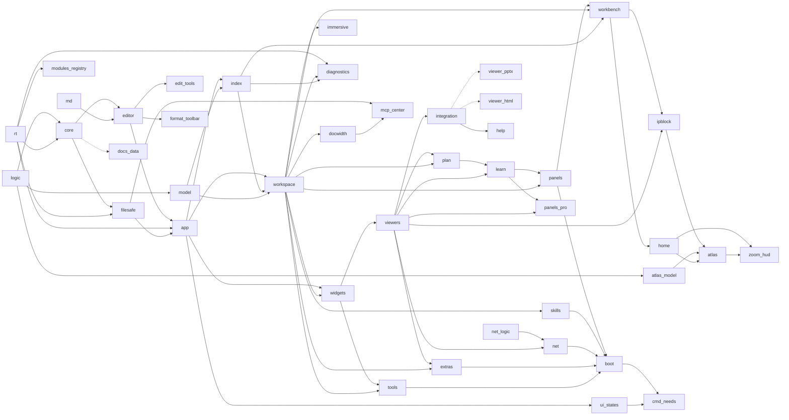

# 前端模块图（自动生成）

由 `tools/check-modules.py --write` 从 `app/modules.json` 生成；加载顺序即表格顺序。虚线 = 懒加载。

| # | 模块 | 层 | 依赖 | 加载 | 说明 |
|---|---|---|---|---|---|
| 1 | `logic.js` | 内核 | — | 启动 |  |
| 2 | `net-logic.js` | 内核 | — | 启动 |  |
| 3 | `model.js` | 内核 | logic | 启动 |  |
| 4 | `md.js` | 内核 | — | 启动 |  |
| 5 | `rt.js` | 内核 | — | 启动 | 运行时服务：统一错误出口、可取消任务、LRU 缓存、性能遥测、模块懒加载 |
| 6 | `core.js` | 内核 | logic, rt | 启动 |  |
| 7 | `filesafe.js` | 内核 | core, rt | 启动 | 安全写入：外部修改冲突检测 + 滚动备份 + 恢复 |
| 8 | `modules-registry.js` | 内核 | rt | 启动 | 由 tools/check-modules.py --write 生成：把本清单交给 rt.modules |
| 9 | `editor.js` | 应用壳 | core, md | 启动 |  |
| 10 | `edit-tools.js` | 应用壳 | editor | 启动 |  |
| 11 | `app.js` | 应用壳 | editor, rt, filesafe | 启动 |  |
| 12 | `index.js` | 工作空间 | app, model | 启动 |  |
| 13 | `workspace.js` | 工作空间 | app, index, model | 启动 |  |
| 14 | `widgets.js` | 文档中心 | app, workspace | 启动 |  |
| 15 | `viewers.js` | 文档中心 | widgets | 启动 |  |
| 16 | `plan.js` | 工程工具 | viewers, workspace | 启动 |  |
| 17 | `learn.js` | 工程工具 | plan, viewers | 启动 |  |
| 18 | `panels.js` | 工作空间 | learn, workspace | 启动 |  |
| 19 | `tools.js` | 工程工具 | widgets, workspace | 启动 |  |
| 20 | `extras.js` | 工程工具 | viewers, workspace | 启动 |  |
| 21 | `net.js` | 工程工具 | net-logic, viewers | 启动 |  |
| 22 | `skills.js` | 自动化中心 | workspace | 启动 |  |
| 23 | `boot.js` | 应用壳 | panels, skills, net, extras, tools | 启动 | 启动：偏好 → 面板 → 工作区 → 会话恢复。其后的“增强模块”在 boot 之后加载并包装部分函数 |
| 24 | `docs-data.js` | 文档中心 | core | 按需 | 内置手册文本（≈68 KB），打开帮助中心时才加载 |
| 25 | `integration.js` | 应用壳 | viewers | 启动 |  |
| 26 | `viewer-pptx.js` | 文档中心 | integration | 按需 | PPTX 高保真查看器（≈56 KB），首次打开 .pptx 时加载 |
| 27 | `viewer-html.js` | 文档中心 | integration | 按需 | 本地 HTML 查看器（≈13 KB），首次打开 .html 时加载 |
| 28 | `format-toolbar.js` | 体验增强 | editor | 启动 |  |
| 29 | `panels-pro.js` | 工程工具 | learn, viewers | 启动 |  |
| 30 | `help.js` | 体验增强 | integration | 启动 |  |
| 31 | `workbench.js` | 工作空间 | panels, workspace, index | 启动 |  |
| 32 | `home.js` | 体验增强 | workbench | 启动 |  |
| 33 | `ipblock.js` | 工程中心 | workbench, viewers | 启动 |  |
| 34 | `atlas-model.js` | 工程中心 | logic | 启动 | IP 图谱统一知识模型：结构/寄存器/场景/时序/代码 + 依据（页码·等级·手册版本）+ 一致性 + 影响分析（纯逻辑，Node 可测） |
| 35 | `atlas.js` | 工程中心 | ipblock, atlas-model, home | 启动 |  |
| 36 | `immersive.js` | 体验增强 | workspace | 启动 | 全屏 / 专注阅读、柔和界面、打开文件容错（原 v16.js） |
| 37 | `zoom-hud.js` | 体验增强 | home, atlas | 启动 | 统一缩放 HUD + 空闲预热（原 v161.js） |
| 38 | `docwidth.js` | 体验增强 | workspace | 启动 | 文档 / 表格宽度四档、项目树跟随磁盘（原 v162.js） |
| 39 | `mcp-center.js` | 自动化中心 | filesafe, docwidth | 启动 | MCP 连接中心 + AI 改动记录（差异 / 撤销 / 自动刷新） |
| 40 | `diagnostics.js` | 体验增强 | rt, workspace, index | 启动 | 耗时探针（打开 / 切换项目 / 切换标签 / 保存 / 索引）+ 诊断与性能报告导出 |
| 41 | `ui-states.js` | 体验增强 | app | 启动 | 统一的加载 / 错误 / 空状态（重试、定位、系统程序打开、复制错误） |
| 42 | `cmd-needs.js` | 应用壳 | boot, ui-states | 启动 | 命令前提表（有标签 / 有磁盘文件 / 是 Markdown）：不满足时面板隐藏、直接触发时给出原因 |

