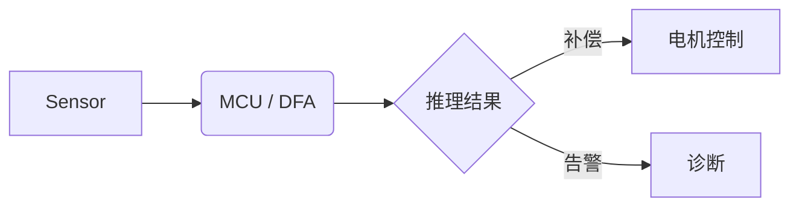

# 欢迎使用 MDView 1.0

MDView 是一个仿 **Typora** 的高性能 Markdown 编辑器：*所见即所得*，单击任意段落即可编辑，按 `Esc` 或点击别处即渲染。编辑内核为 **CodeMirror 6**。

[TOC]

## 快速上手

- **插入任何东西**：在空行行首输入 `/`，例如 `/bg` 表格、`/lct` 流程图、`/sx` 时序图、`/db` 待办
- **命令面板** `Ctrl+Shift+P`；`Ctrl+P` 后输入 `=0x3F<<4` 可做进制 / 位运算
- **AI 助手** `Ctrl+J`：选中文字 → 浮动工具栏「AI」→ 润色 / 翻译 / 整理成表格
- **从模板新建** `Ctrl+Alt+N`：会议纪要、周报、客户问题跟踪、样品申请、培训讲稿…
- **导出**：Word、PowerPoint（`---` 分页）、Outlook 邮件草稿、PDF、HTML

> [!TIP]
> 用「文件 → 打开文件夹」后，可使用文件树、双链、关系图谱、待办汇总与全局搜索；粘贴截图会自动保存到 `assets/`。

## 文本样式

**粗体**、*斜体*、~~删除线~~、==高亮==、`行内代码`、<u>下划线</u>、H~2~O、x^2^、<kbd>Ctrl</kbd>+<kbd>S</kbd>、:rocket:

链接：[Renesas](https://www.renesas.com)，双链：[[项目周报]]，脚注[^1]。

## 待办

- [x] 完成 DFA 培训 PPT 初稿 📅 2026-10-16
- [ ] 提交 U2B24-E 样品申请 📅 2026-10-22
- [ ] 寄送 U2A 开发板 !! 📅 2026-10-21

## 表格

| 模式     | 快捷键       | 说明                     |
| :------- | :----------: | -----------------------: |
| 实时预览 | `Ctrl+/`     | 块级所见即所得           |
| 源代码   | `Ctrl+/`     | CodeMirror 6，百万字流畅 |
| 分屏     | `Ctrl+Alt+/` | 按行同步滚动             |

## 代码、公式与图表

```c
/* Cogging torque compensation */
for (int i = 0; i < N; i++) {
    comp += w[i] * sinf(i * theta + phi[i]);
}
```

$$
T_{cog}(\theta) = \sum_{k=1}^{\infty} T_k \sin(k N_L \theta + \varphi_k)
$$



```wavedrom
{ signal: [
  { name: "clk",  wave: "p......" },
  { name: "cs",   wave: "10....1" },
  { name: "data", wave: "x.3456x", data: ["A0","A1","D0","D1"] }
]}
```

> [!NOTE]
> 公式与图表渲染库优先从 lib/ 目录加载（桌面版已内置），否则联网加载；离线时显示源码，不影响编辑。

[^1]: 这是一个脚注，点击编号可来回跳转。
